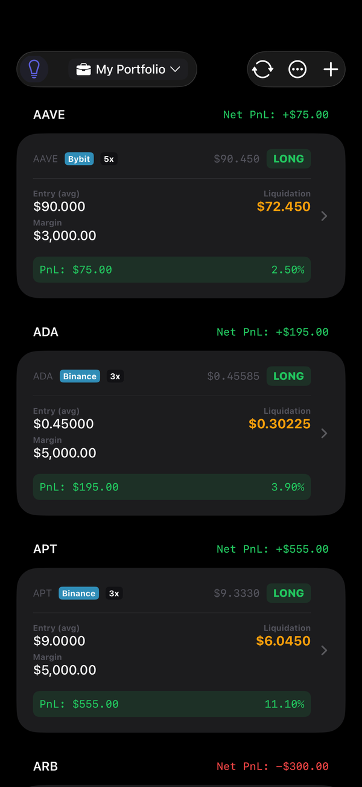
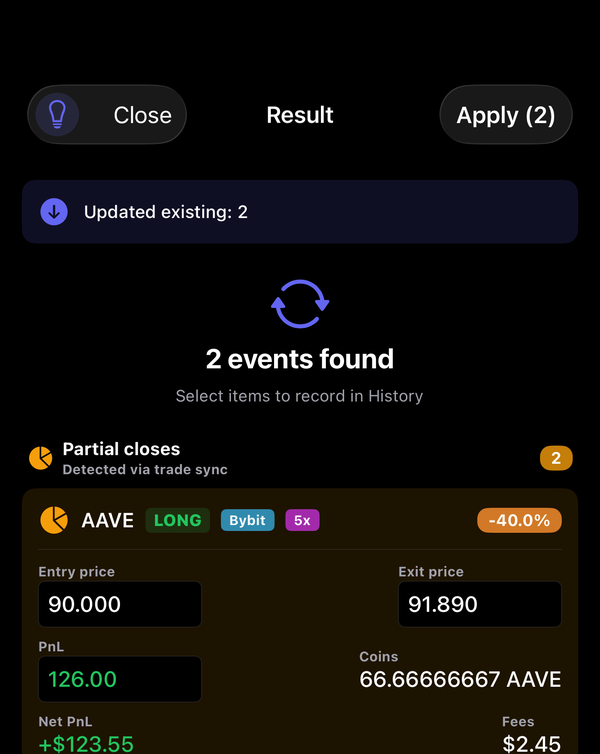
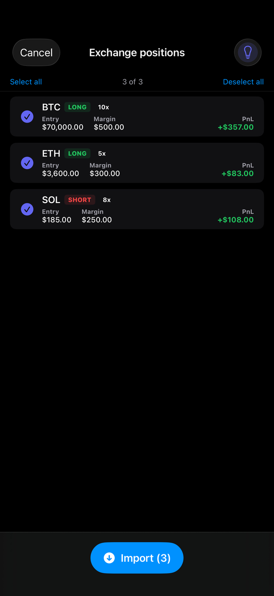
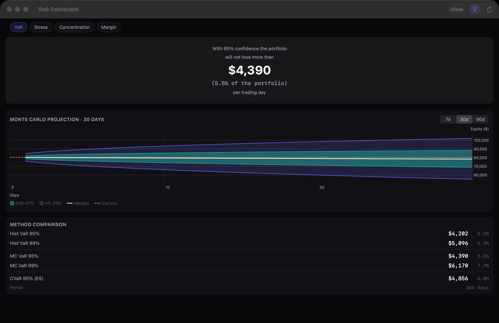

<div align="center">

  

  <h1>Cursaris</h1>

  <p><b>A portfolio and risk app for crypto-futures traders, built to bring positions from 11 exchanges into one view.</b><br/>
  A native app for iPhone, iPad, Mac and Apple Watch, closed source and being prepared for App Store submission.<br/>
  No account: portfolio data is stored only on the device, and API keys go only to the exchange they belong to.</p>

  <p>
    
    
    
    
  </p>

  <p>
    <a href="#highlights">Highlights</a> |
    <a href="#screenshots">Screenshots</a> |
    <a href="#architecture">Architecture</a> |
    <a href="#how-it-is-built-and-verified">How it is built</a> |
    <a href="#code-walkthrough">Code walkthrough</a>
  </p>

  

</div>

---

## Highlights

- **Built with Claude Code under a verification layer I designed.** Generated code is treated as wrong until a check proves otherwise: about 4,700 tests, plus scripts that drive a debug build and check 121 screens with Apple's Vision framework.
- **One protocol for 11 exchanges.** The exchanges use five different request-signing schemes, and all 11 sit behind one Swift protocol that declares only read methods. Eight exchanges have been added without changing the sync engine.
- **A sync that catches partial closes.** Each futures sync looks for closed trades before it imports anything, so a partial close is caught before the new position size overwrites the old one. Every detected close waits in an approval inbox before it reaches the trade history.
- **Reproducible risk figures.** Historical Value at Risk and expected shortfall, plus a Monte Carlo VaR over 5,000 correlated scenarios through a Cholesky factor applied with Accelerate. It is seeded from its inputs, so the same portfolio on the same price history always gets the same figure.
- **Plain-language plans with on-device AI.** A rule written in plain English or Russian becomes a structured plan. A rule-based parser runs first, and when its confidence is below 0.8 on iOS or macOS 26 with Apple Intelligence, Apple's on-device Foundation Models return the plan in a typed schema that the app validates before use.
- **Networking on Swift actors.** The HTTP client and Deribit's token store are actors. Actors are re-entrant, so the token store keeps a map of logins in flight, and 20 simultaneous requests trigger one login.

## Screenshots

<table>
  <tr>
    <td align="center" valign="top"></td>
    <td align="center" valign="top"></td>
    <td align="center" valign="top"></td>
  </tr>
  <tr>
    <td align="center"><sub>Positions from Bybit and Binance in one portfolio</sub></td>
    <td align="center"><sub>Detected partial closes wait for approval</sub></td>
    <td align="center"><sub>Import preview: nothing is written until you confirm</sub></td>
  </tr>
  <tr>
    <td align="center" colspan="3"><br/><sub>Value at Risk on the Mac, historical and Monte Carlo, with expected shortfall</sub></td>
  </tr>
</table>

## What it does

**Exchange sync.** Each of the 11 exchange integrations is built for read-only API keys. Open positions follow the exchange on each sync, which runs every one to five minutes, and prices refresh every three seconds in between. The sync detects partial and full closes, aggregates fills into a volume-weighted exit price and de-duplicates by exchange trade ID. When the fills do not explain a change in size, it compares position sizes directly, so a close is still caught if an exchange's trade history call fails. One failing exchange never blocks the others.

**Positions.** For futures: leverage, a DCA plan with the averaged entry and the estimated liquidation price it leads to, distance to liquidation in percent and in ATR, and funding cost at each exchange's own settlement interval, per day and per year. Spot holdings with FIFO, LIFO, HIFO or average cost basis. Closed trades with filters, grouping, editing and a per-trade journal.

**Risk.** Stress tests take the drawdowns of four past crashes (March 2020, LUNA, Three Arrows Capital, FTX) and spread each shock through the correlation matrix to show which positions would be liquidated. Concentration is scored with the Herfindahl index, and a margin forecast estimates the days left before a margin call.

**Tax.** Spot and futures gains under three country presets or your own rules, including US Section 1256 60/40 treatment for futures. It finds tax-loss harvesting opportunities. Reports export to PDF and CSV and can be compared line by line with one you exported earlier.

**Plans and backtesting.** Trading plans turn conditions on price, ROE, funding, RSI or distance to liquidation into notifications, position badges, journal entries or webhooks. Backtesting runs a parallel grid search over up to 500 parameter combinations. Walk-forward validation labels a strategy robust, moderate or overfit, and a Monte Carlo reshuffle of its trades estimates the risk of ruin.

**On-chain.** Token balances on five EVM chains, batched through Multicall3 with an in-house Keccak-256 and ABI encoder.

**Import.** CSV exports in 14 formats from 9 exchanges, parsed on a dedicated actor, with a preview before anything is written.

**Apple platforms.** Home-screen widgets that re-price positions without opening the app, a Live Activity and a Control Center control on iOS, and an Apple Watch app with complications that receives a debounced snapshot from the phone. Eight languages, with a CI audit of every pushed change to the main app's string catalogs.

---

## Architecture

```mermaid
flowchart TD
    App[CursarisApp] --> DM[DataManager<br/>@Observable, @MainActor]
    App --> Sync[Auto-sync and reconciliation]
    Sync --> DM
    Sync --> Provider[ExchangeProvider protocol<br/>read methods only]
    Provider --> EX["one service per exchange<br/>signing, mapping, rate limiting"]
    DM --> Store[(SwiftData)]
    DM --> Engines["Engines<br/>risk, tax, correlation, on-chain, strategy"]
    DM --> Views[SwiftUI on iOS, iPadOS and macOS]
    Engines --> Views
    DM --> Watch[watchOS app<br/>snapshot over WatchConnectivity]
    Store --> Widgets[Widgets read the shared store]
```

In development since February 2026. The app depends on no third-party code: its Xcode project has zero package references and no vendored libraries. Positions are served from an in-memory index with separate price and structure versions, so a three-second price tick redraws the position lists from memory and only a data change rebuilds the index.

### One protocol for every exchange

Every exchange sits behind a single `ExchangeProvider`. Adding a futures exchange means a service with its mappers and model layer plus a signing function when the exchange signs each request, along with entries in shared registries such as the exchange config and the public price feeds. The exchanges disagree on almost every axis that matters:

| Axis | How the exchanges differ |
|---|---|
| **Signing** | Five families: HMAC-SHA256 to Base64; HMAC-SHA256 to hex; HMAC-SHA512 over a SHA-512 body hash; HMAC-SHA384; HMAC-SHA512 over a SHA-256 pre-hash, in two different orders |
| **Shape** | Keyed JSON against Bitfinex's positional arrays; success signalled by `code: 0`, by `code: "0"`, or by HTTP status alone |
| **Paging** | Cursors, page numbers, and continuation tokens carried in HTTP headers |
| **Quirks** | Dual domains with dual auth schemes, a passphrase that must itself be HMAC-hashed, a four-credential model, stateful bearer tokens, and ticker formats from `XBTUSDTM` to `tBTCF0:USTF0` normalized to one symbol |

Access is read-only by design: the provider protocol declares only read methods. Every key is stored only in the device Keychain and never synced to iCloud, and a log sanitizer masks keys and signatures in every logged request.

### Networking

The HTTP client is a Swift actor. It turns 429, 418 and maintenance responses into typed errors, caps every request at 60 seconds and pauses syncing while the device is offline. A transport or 502/503 error gets one retry, after a jittered delay and a fresh connectivity check.

### The sync pipeline

Each futures sync runs four steps in a fixed order: fetch, detect, import, reconcile. Detection comes before import, while the old position sizes are still stored, so a partial close is caught before the new size overwrites it. Every close the sync detects, partial or full, waits in an approval inbox before it is written to the trade history, and a partial close's exit price and PnL can be corrected there first. A sync updates only trading fields such as leverage, entry, margin and mark price, so the target price and DCA steps you entered stay as they are.

---

## How it is built and verified

Cursaris is written with Claude Code as the implementation tool. The architecture and the verification layer are mine. That layer starts from one assumption: generated code is wrong until something proves otherwise. A fix is proven by reverting it and checking that exactly the predicted tests fail.

**Tests.** About 4,700 tests and 11,400 assertions, almost all in Swift Testing, with none disabled. They concentrate where mistakes cost money: exchange mappers, signing, the reconciliation chain, position math and every quantitative engine. Golden-value tests pin core formulas to known values, from the liquidation price with maintenance margin to the US Section 1256 60/40 split.

**Scripted end-to-end runs.** A debug-only JSON-RPC server with 54 methods lets scripts drive the app. An invariant fuzzer checks 45 invariants. Deterministic scenarios and multi-step user journeys run the app's main flows end to end, and stress runs add concurrent load and simulated multi-day sessions.

**Visual audit.** A screenshot tour captures 121 screens and states on the Mac and at five iPhone and iPad sizes, and Apple's Vision framework flags clipped text and leaked localization keys.

**Contract-drift checks.** Scripts compare what the app assumes about the exchanges' APIs with what those APIs return today, from the JSON types the app decodes to the fee and margin constants it calculates with.

**Pre-release gate.** A 74-check script, nearly all of the checks blocking. Its latest run passed every one.

**Debug tooling stays out of release builds.** All debug tooling sits behind `#if DEBUG`, and a check scans the compiled Release binary for the name of any debug type.

---

## Code walkthrough

Cursaris is closed source and being prepared for App Store submission: privacy manifests with required-reason declarations for all four app and extension targets, StoreKit 2 subscriptions with verified entitlements, a demo mode so App Store reviewers need no exchange keys, and store metadata in eight languages. This repository is a public overview of the app and its architecture.

I would be glad to walk you through the code on a call, starting with the architecture and then going as deep as you like into one part, for example the reconciliation engine or the signing layer.

---

## Author

**Oleksandr Uskov**, iOS engineer in Warsaw, MSc Computer Science student

- Email: oleksandruskov.it@gmail.com
- Telegram: [@Alexus27](https://t.me/Alexus27)
- LinkedIn: [oleksandr-uskov](https://www.linkedin.com/in/oleksandr-uskov/)

---

<sub>Cursaris is a portfolio and risk app. Nothing in it is financial advice.</sub>
