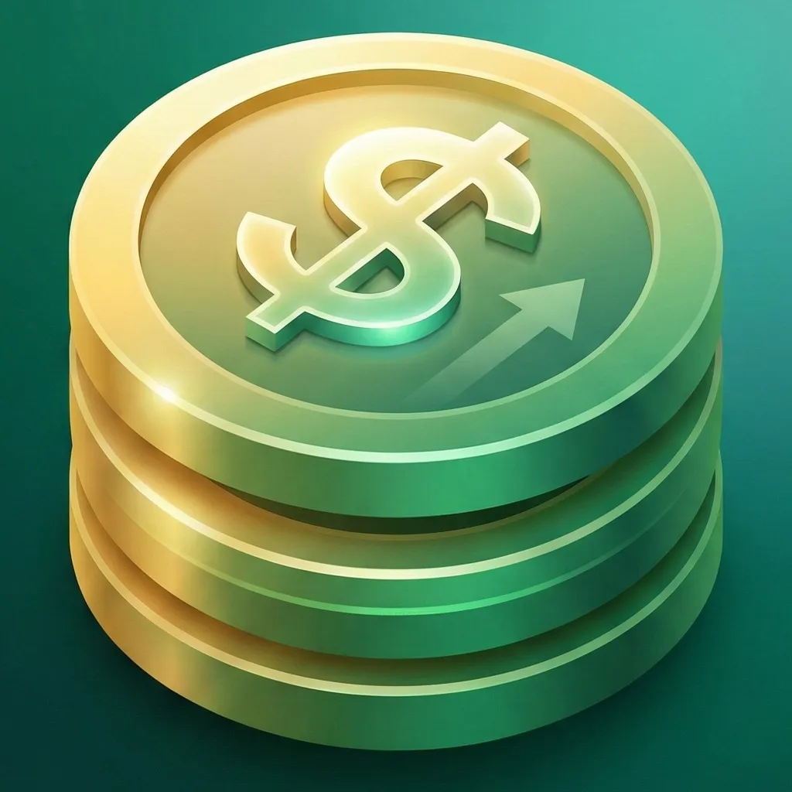
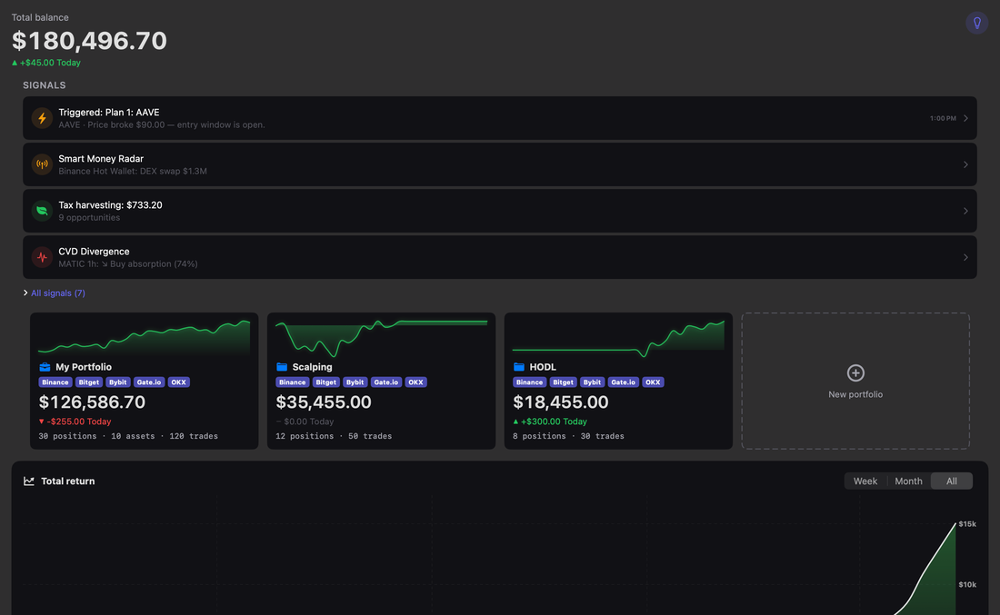
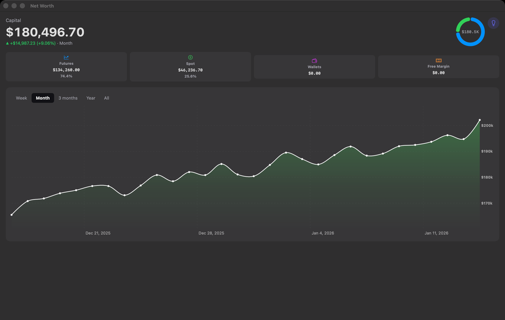
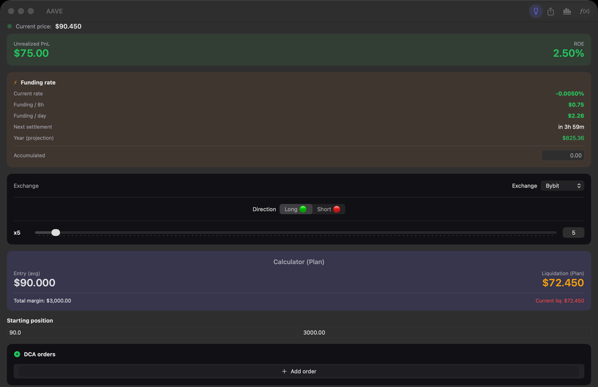
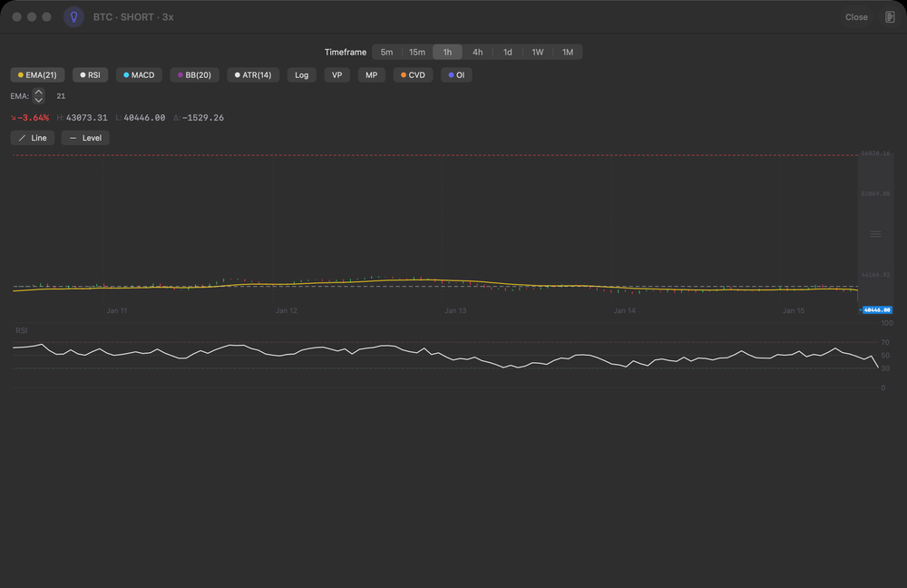
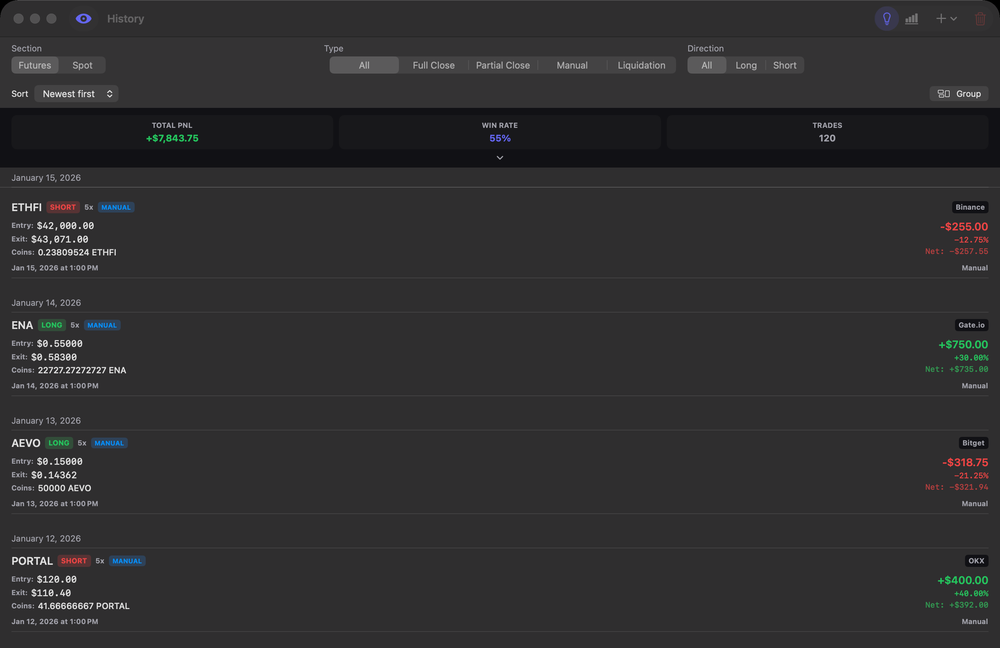
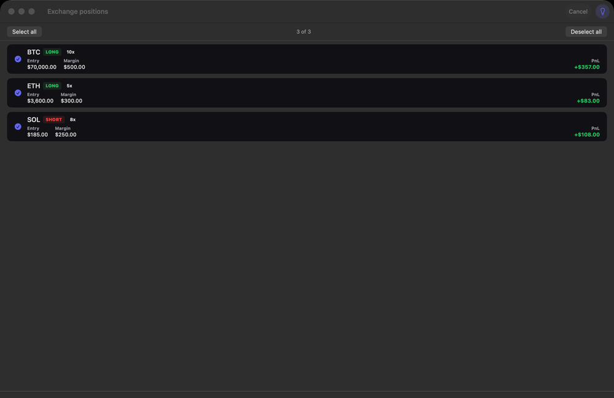
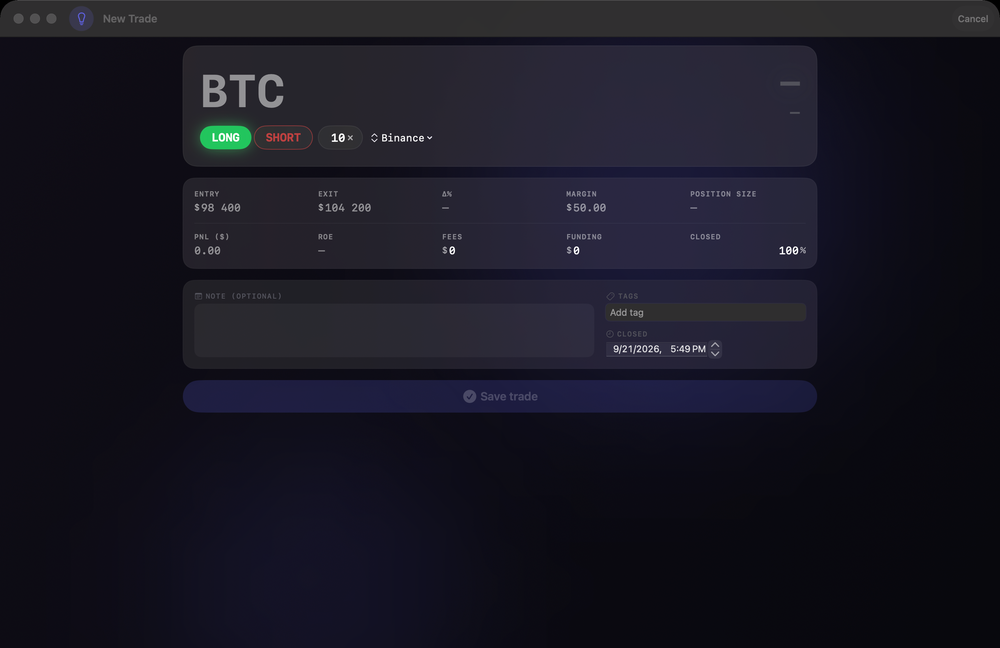
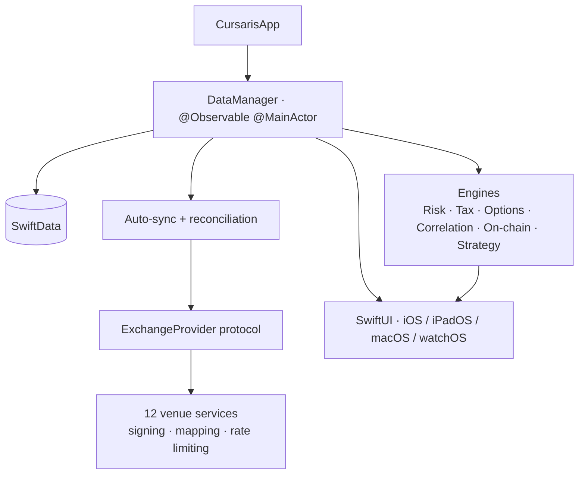

  

  <h1>Cursaris</h1>

  
<b>One honest view of a crypto-futures book spread across twelve exchanges.</b> 
  Native on iPhone, iPad, Mac and Apple Watch. Your keys and your data never leave the device.

  

    
    
    
    
    
    
  

  

    <a href="#-screenshots">Screenshots</a> ·
    <a href="#-architecture">Architecture</a> ·
    <a href="#-how-it-is-verified">Verification</a> ·
    <a href="#-source-code--access">Request a walkthrough</a>
  

  

---

## The problem

A trader with positions on four exchanges has four different truths. Each venue shows its own
slice, in its own format, with its own idea of what a "closed" position means. Nothing tells you
what the whole book is worth, what it costs to hold overnight, how close you are to a liquidation
you did not plan for, or what you will owe when the year ends.

Cursaris is the single place that answers those questions — on your own hardware, without handing
anyone your keys.

---

## What it does

**Brings twelve exchanges into one book.** Read-only API keys, live positions, and a sync engine
that reconciles what the venue says against what you already have. It detects partial closes,
full closures and reopened positions, aggregates fills into a weighted-average exit price,
deduplicates by trade ID, and falls back to a balance diff when an exchange's trade endpoint
degrades. One failing venue never blocks the others.

**Tracks the position, not just the number.** Leverage, DCA laddering, liquidation and breakeven
estimates for futures. Spot holdings with FIFO, LIFO, HIFO or weighted-average cost basis. Closed
trades with filtering, grouping, editing and a per-trade journal.

**Tells you what the book risks.** Value at Risk both historically and by Monte Carlo over
correlated price paths, stress scenarios that propagate a shock through the correlation matrix so
a hedge behaves like a hedge, concentration limits and margin forecasting.

**Answers the tax question before the deadline does.** Per-jurisdiction spot and futures gains,
harvesting opportunities, PDF and CSV export, and a comparison against the report you already
filed so you can see exactly what moved.

**Reads the market around the position.** Options Greeks and implied-volatility surface, max pain,
put/call ratio, funding across venues, open interest, liquidation heatmaps, correlation with
traditional markets.

**Automates what you would otherwise watch for.** Trading plans that turn conditions into actions,
built visually or written in plain language. Strategy backtesting with Monte Carlo and
walk-forward validation. On-chain balances and Aave health factors across five EVM chains.

**Fits the platform.** Interactive home-screen widgets, App Intents, Live Activities, a watchOS
companion, and hardware-wallet reading over NFC. Eight languages. Dark throughout.

---

## 📸 Screenshots

<table>
  <tr>
    <td align="center"> Net worth across venues</td>
    <td align="center"> Futures position with DCA ladder</td>
  </tr>
  <tr>
    <td align="center"> Technical chart</td>
    <td align="center"> Reconciled trade history</td>
  </tr>
  <tr>
    <td align="center"> Exchange connections</td>
    <td align="center"> Import preview before anything is written</td>
  </tr>
</table>

More

<table>
  <tr>
    <td align="center"> Manual trade entry</td>
  </tr>
</table>

---

## 🏗 Architecture

Roughly 250,000 lines of Swift across 739 files, built over six months. No third-party packages
at all — not a single SPM dependency in the project.

### One protocol, twelve venues

Every exchange sits behind a single `ExchangeProvider`. Adding one means a service, a mapper, a
model layer and a signing variant, and touching nothing in the sync engine. They disagree on
almost every axis that matters:

| | |
|---|---|
| **Signing** | Six families across twelve venues: HMAC-SHA256 to Base64 and to hex, HMAC-SHA512 with a body pre-hash, HMAC-SHA384, a dual SHA-256 → HMAC-SHA512 scheme with two different pre-hash orders, and asymmetric JWT ES256 over ECDSA P-256 |
| **Shape** | Keyed JSON against Bitfinex's positional arrays; success signalled by `code: 0`, by `code: "0"`, or by HTTP status alone |
| **Paging** | Cursors, page numbers, and continuation tokens carried in HTTP headers |
| **Quirks** | Dual domains with dual auth schemes, a passphrase that must itself be HMAC-hashed, a four-credential model, stateful bearer tokens, and ticker formats from `XBTUSDTM` to `tBTCF0:USTF0` normalized to one symbol |

Keys are read-only by construction. The provider protocol declares no write method — there is no
order placement code anywhere in the project — and every key is stored in the Keychain,
device-only, never synced.

### The sync pipeline

Fetch → detect → import → reconcile, in that order and deliberately so. Detection runs while
local fill counts are still intact, which is what stops a partial close from being silently
absorbed by the import that follows it. Everything the sync wants to change is shown for approval
before it touches the ledger.

---

## 🔬 How it is verified

A codebase this size, written this fast, is only worth anything if it is checked harder than it
is written. Roughly a third of the project is the machinery that does the checking.

**4,500+ tests, 10,000+ assertions.** Test code to production code runs about one to two. They
concentrate where mistakes cost money: exchange mappers, the reconciliation chain, position math,
and every quantitative engine. Each runs against an in-memory store.

**An autonomous bug hunter, twelve vectors.** An invariant fuzzer over 45 invariants, 79
deterministic scenarios, a guided UI monkey, multi-step user journeys, performance benchmarks,
an accumulation fuzzer, and chaos engineering that feeds the app 34 hostile API responses,
concurrent load, and simulated multi-day sessions.

**A visual audit.** Every screen is photographed on two platforms and triaged through Apple's
Vision framework for clipped text, leaked localization keys and language bleed.

**Contract-drift checkers.** Eight scripts compare what the app assumes about each venue's API
against what that venue actually returns, so a breaking change abroad surfaces here before a user
finds it.

**A release gate.** Eleven checks, eight of them blocking, run before anything ships.

**Debug tooling that ships as zero bytes.** The entire instrumentation layer is compiled out of
release builds, verified against the binary rather than by searching the source.

CI enforces the localization and consistency gates on every push. The full test suite runs
locally before a release, because a meaningful share of it talks to live exchange APIs and would
be flaky on a hosted runner.

---

## 🤖 Built by one person, with AI

Cursaris is written with Claude Code as the implementation tool. The interesting part was never
the generation — it was building a system that assumes generated code is wrong until something
proves otherwise, and then shipping at a pace that only makes sense with that system in place.

That system is in the repository as much as the app is: a debug RPC server, a screenshot harness,
static audits enforcing structural and localization invariants, drift checkers against every
external API, and a discipline of proving a fix by predicting exactly which tests will fail when
it is reverted. Roughly 39,000 lines of Python exist purely to keep the Swift honest.

The design decisions, the architecture and the verification layer are mine. So is every defect
this machinery has caught, and there is a written record of each one.

---

## 🔒 Source code & access

Cursaris is a commercial, closed-source product currently in pre-submission hardening for the
App Store, so the source is not public. This repository documents the architecture.

I am glad to give a private walkthrough on a call: a guided tour of the architecture, a deep dive
into whichever subsystem you find most interesting — the reconciliation engine and the signing
layer are the usual choices — and a live debugging session in the real codebase if that is useful.

---

## 👤 Author

**Oleksandr Uskov** — MSc Computer Science student · AI-augmented solo developer

- Email: oleksandruskov.it@gmail.com
- Telegram: [@Alexus27](https://t.me/Alexus27)
- LinkedIn: [oleksandr-uskov](https://www.linkedin.com/in/oleksandr-uskov/)

---

Cursaris is a portfolio and analytics tool. It does not place orders, and nothing in it is
financial advice.
